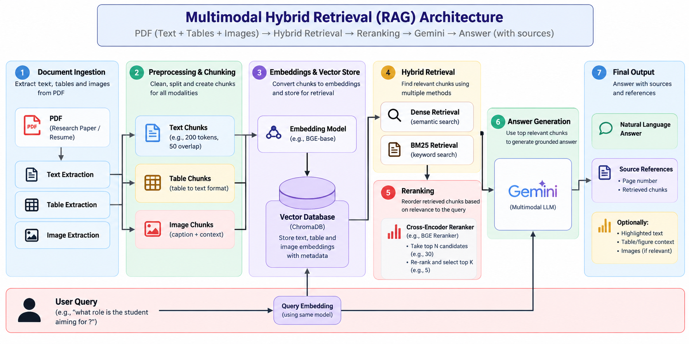

# Multimodal Hybrid Retrieval-Augmented Generation (RAG)

<p align="center">
  <a href="https://multimodalhybridrag-lsiju6loof6eseqrpuubsw.streamlit.app/">
    <strong>🚀 Try the Live Demo</strong>
  </a>
</p>

<p align="center">
  A research-paper assistant that combines multimodal document processing, dense semantic search, keyword retrieval, reranking, and grounded answer generation.
</p>

## Architecture



## Overview

**Multimodal Hybrid RAG** is a document-question-answering application designed to help users explore research papers and other PDF documents. It processes document content, retrieves evidence relevant to a question, and uses a large language model to generate an answer supported by retrieved context.

The pipeline brings together document ingestion, text/table/image extraction, chunking, embeddings, hybrid retrieval, reranking, and answer generation.

## How It Works

1. **Document Ingestion** — Upload a PDF, such as a scientific paper or résumé.
2. **Multimodal Extraction** — Extract document text, tables, and image/figure assets where supported by the ingestion pipeline.
3. **Preprocessing and Chunking** — Clean and divide extracted content into smaller units for retrieval. Table and image context can be represented alongside text.
4. **Embeddings and Vector Storage** — Convert supported chunks into embeddings and store them with relevant metadata for similarity search.
5. **Hybrid Retrieval** — Combine dense semantic retrieval with BM25 keyword retrieval to find evidence matching the user's question.
6. **Reranking** — Reorder retrieved candidates by relevance before selecting context for generation.
7. **Answer Generation** — Send the selected evidence to Gemini to generate a context-grounded response.
8. **Source-Aware Output** — Present the answer with available source details, such as document/page references and retrieved evidence, to make verification easier.

## Key Features

- **PDF-Based Question Answering** for research papers and résumé-style documents.
- **Multimodal Document Processing** for text, tables, and visual assets where supported by the ingestion pipeline.
- **Hybrid Search** using semantic and keyword retrieval.
- **Reranking** to prioritize more relevant retrieved candidates.
- **Gemini-Powered Generation** using retrieved context.
- **Evidence and Source References** to help users check generated answers.
- **Out-of-Domain Handling:** Tested with an unrelated question, the system responded that the source paper did not cover that topic.

## Technology Stack

- **Python** — Application and pipeline logic
- **PyMuPDF** — PDF text extraction and document processing
- **Sentence Transformers** — Text embeddings
- **BM25** — Lexical/keyword retrieval
- **Vector Database** — Embedding storage and similarity retrieval
- **Gemini API** — Answer generation
- **Streamlit** — Interactive web interface

> Update this section to match the exact embedding model, vector-store configuration, chunking parameters, and reranking implementation in the final repository.

## Evaluation and Testing

The first end-to-end version was tested on a scientific paper about face-morph detection.

Example checks included:

- Asking which evaluated model had the highest accuracy and requesting its F1 score.
- Asking where a comparison chart appears in the document.
- Asking an unrelated question about cancer to check whether the system would avoid attributing unsupported information to the paper.

These checks helped validate document-grounded question answering and basic out-of-domain behavior. They are **functional checks, not a complete benchmark**.

A more rigorous evaluation should report retrieval metrics such as Recall@K and MRR, answer correctness and faithfulness, latency, and performance across a larger test set.

## Running Locally

1. Clone this repository.
2. Create and activate a Python virtual environment.
3. Install the dependencies listed in `requirements.txt`.
4. Configure your Gemini API key using an environment variable or Streamlit secrets.
5. Start the Streamlit application using the entry-point file in the repository.

Example commands — adjust the repository URL, folder name, and entry-point filename as needed:

```bash
git clone <YOUR_GITHUB_REPOSITORY_URL>
cd <YOUR_REPOSITORY_FOLDER>

python -m venv .venv

# Windows
.venv\Scripts\activate

# macOS/Linux
source .venv/bin/activate

pip install -r requirements.txt
streamlit run app.py
```

### API Key Configuration

Keep API keys out of source control.

- For local development, use a `.env` file if the application is configured to read it, and add `.env` to `.gitignore`.
- For Streamlit Community Cloud, configure the secret in the application's **Secrets** settings.

Example secret format:

```toml
GEMINI_API_KEY = "your_api_key_here"
```

Use the variable name expected by your application. Never commit a real API key.

## Repository Structure

The following structure is illustrative. Adjust the names to match the actual repository.

```text
.
├── app.py
├── Rag_architecture.png
├── requirements.txt
├── src/
│   ├── ingestion/
│   ├── retrieval/
│   ├── reranking/
│   └── generation/
├── tests/
└── README.md
```

## Current Scope and Limitations

- Retrieval quality depends on extraction quality, chunking, embeddings, and the candidates returned by the retrievers.
- Reranking can reorder retrieved candidates but cannot recover evidence that was never retrieved.
- Tables and figures may require additional processing to preserve their meaning; extraction quality can vary by PDF layout.
- Generated answers should be checked against the cited document evidence.
- The live application and repository configuration should be tested after deployment or dependency changes.

## Roadmap

- Systematically compare embedding models and chunking strategies.
- Measure retrieval quality with a labeled evaluation set.
- Improve table and figure understanding.
- Add bounded query-rewriting and retrieval retries for weak evidence.
- Explore self-healing retrieval with measurable fallback and abstention behavior.
- Add latency, error, and retrieval-quality monitoring.

## Security

- Do not commit API keys, credentials, private documents, or personal information.
- Review uploaded-document handling before using sensitive files.
- Keep dependencies updated and validate configuration before deployment.

## Acknowledgements

Built as an applied AI engineering project exploring multimodal document ingestion and hybrid retrieval for grounded question answering.
