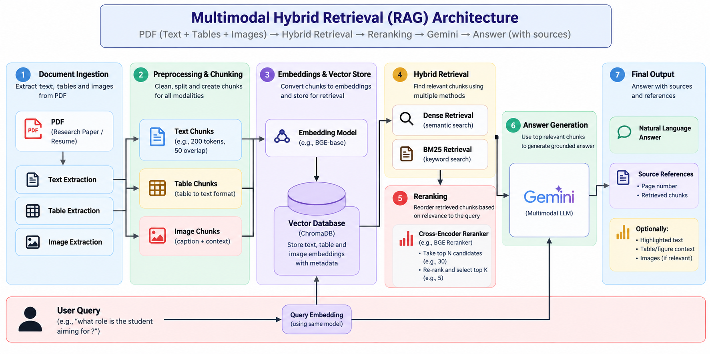

# Multimodal Hybrid Retrieval-Augmented Generation (RAG)

<p align="center">
  <a href="http://multimodal-rag.indiasouthcentral.cloudapp.azure.com:8501">
    <strong>🚀 Try the Live Demo</strong>
  </a>
</p>

<p align="center">
  A research-paper assistant combining multimodal document processing, hybrid retrieval, reranking, and evidence-grounded answer generation.
</p>

---

## Architecture



## Overview

**Multimodal Hybrid RAG** is a document-question-answering application that helps users explore scientific papers and other PDF documents.

The system processes document content, retrieves relevant evidence using multiple retrieval strategies, and generates answers grounded in the retrieved context.

It combines document ingestion, text/table/image extraction, structure-aware chunking, embeddings, hybrid retrieval, reranking, and LLM-based answer generation.

## How It Works

1. **Document Ingestion** — Upload a PDF, such as a scientific paper or résumé.
2. **Multimodal Extraction** — Extract document text, tables, and image/figure assets.
3. **Preprocessing and Chunking** — Process extracted content into retrieval-ready chunks while retaining relevant document metadata.
4. **Embeddings and Vector Storage** — Generate text embeddings and store them with metadata for semantic similarity retrieval.
5. **Hybrid Retrieval** — Combine dense semantic retrieval with BM25 keyword retrieval.
6. **Multimodal Retrieval** — Retrieve relevant visual content using CLIP-based image retrieval and support table retrieval.
7. **Reranking** — Apply Cross-Encoder-based reranking to prioritize relevant candidates.
8. **Evidence Construction** — Combine retrieved text, table, and image evidence into context for answer generation.
9. **Answer Generation** — Use OpenRouter to generate answers grounded in the retrieved evidence.
10. **Source-Aware Output** — Present answers with available source information, page references, and supporting evidence.

## Key Features

- **PDF-Based Question Answering** for research papers and résumé-style documents.
- **Multimodal Document Processing** for text, tables, and visual assets.
- **Hybrid Search** combining dense semantic retrieval and BM25 keyword retrieval.
- **CLIP-Based Image Retrieval** for retrieving relevant visual content.
- **Table Retrieval** to support questions involving tabular information.
- **Cross-Encoder Reranking** to improve the ordering of retrieved candidates.
- **Evidence Construction** to provide relevant context to the answer-generation model.
- **OpenRouter Integration** for LLM-based answer generation.
- **Source References** to help users verify generated answers.
- **Abstention Handling** to avoid answering questions unsupported by the source document.

## Technology Stack

| Component | Technology |
|---|---|
| Programming Language | Python |
| PDF Processing | PyMuPDF |
| Text Embeddings | Sentence Transformers |
| Vector Storage | ChromaDB |
| Keyword Retrieval | BM25 |
| Image Retrieval | CLIP |
| Reranking | Cross-Encoder |
| LLM Integration | OpenRouter API |
| Application Interface | Streamlit |
| Testing | Pytest |

## Evaluation and Testing

The system was evaluated using a test dataset of **30 questions**, consisting of 29 answerable questions and 1 unanswerable question.

### Retrieval Evaluation

| Metric | Result |
|---|---:|
| Recall@5 | **81.61%** |
| Precision@5 | **26.90%** |
| Hit Rate@5 | **86.21%** |
| MRR@5 | **77.59%** |

### Qualitative Evaluation

| Metric | Result |
|---|---:|
| Faithfulness | **100%** |
| Answer Relevancy | **100%** |
| Citation Correctness | **94.05%** |
| Correct Abstention | **100%** |

**Evaluation summary:**
- Total questions: 30
- Answerable questions: 29
- Unanswerable questions: 1
- Successful evaluations: 30
- Failed evaluations: 0

The qualitative results are automated evaluator scores and should be interpreted alongside manual inspection of generated answers and citations.

These results provide an initial evaluation of retrieval quality, answer grounding, citation behavior, and abstention. Further testing on larger and more diverse datasets is needed.

## Running Locally

### 1. Clone the Repository

```bash
git clone https://github.com/chandu2006-git/Multimodal_hybrid_RAG.git
cd Multimodal_hybrid_RAG
```

### 2. Create a Virtual Environment

```bash
python -m venv .venv
```

Activate it:

**Windows PowerShell**
```powershell
.\.venv\Scripts\Activate.ps1
```

**macOS/Linux**
```bash
source .venv/bin/activate
```

### 3. Install Dependencies

```bash
python -m pip install -r requirements.txt
```

### 4. Configure the API Key

Create a `.env` file in the project root:

```env
OPENROUTER_API_KEY=your_openrouter_api_key
```

Keep `.env` in `.gitignore`. Never commit API keys or other credentials.

### 5. Run the Application

```bash
python -m streamlit run app.py
```

Open the local URL displayed in your terminal.

## Running the Evaluation

The repository includes an evaluation pipeline for measuring retrieval and answer-generation performance.

Example command:

```powershell
$env:PYTHONPATH = "$PWD\src"

python -m evaluation.run_evaluation `
  --mode full `
  --judge `
  --force `
  --pdf "path/to/your/research_paper.pdf"
```

The evaluation pipeline supports retrieval evaluation, full answer evaluation, and metrics-only aggregation.

Results are saved under the evaluation results directory, including summary metrics and question-level evaluation outputs.

## Repository Structure

```text
Multimodal_hybrid_RAG/
│
├── app.py
├── requirements.txt
├── .env.example
├── RAG_architecture.png
│
├── src/
│   ├── ingestion/
│   ├── rag/
│   ├── retriever/
│   └── generation/
│
├── evaluation/
│   ├── quantitative_metrics.py
│   ├── qualitative_metrics.py
│   ├── run_evaluation.py
│   └── results/
│
├── data/
│   ├── raw_pdfs/
│   └── evaluation/
│
├── tests/
│
└── README.md
```

## Current Scope and Limitations

- Retrieval performance depends on document extraction quality, chunking, embeddings, and candidate selection.
- Reranking can reorder retrieved candidates but cannot recover evidence that was never retrieved.
- Complex tables and figures may require additional processing to preserve their full meaning.
- Generated answers should always be checked against the supporting document evidence.
- Evaluation results are based on the current test dataset and may not represent performance across all document types.
- Application availability depends on the hosting environment and deployment configuration.

## Roadmap

- Compare embedding models and chunking strategies systematically.
- Improve retrieval precision and citation reliability.
- Strengthen table and figure understanding.
- Introduce adaptive retrieval and bounded query-rewriting strategies.
- Explore self-healing retrieval with measurable fallback and abstention behavior.
- Add latency, error, and retrieval-quality monitoring.

## Security

- Never commit API keys, credentials, or private documents.
- Store secrets in environment variables or the hosting provider's secret-management settings.
- Review uploaded-document handling before processing sensitive files.
- Keep dependencies updated and validate deployment configuration.

## Acknowledgements

Built as an applied AI engineering project exploring multimodal document processing, hybrid retrieval, and grounded question answering.
